<!-- The SVGs are generated: edit scripts/build-readme.mjs, then run `node scripts/build-readme.mjs`. Stats, city, trophies, repos and the daily quote are refreshed by .github/workflows/update-readme.yml -->

  


  


  


  


  


  


  


  


  


  

 
<a href="https://linkedin.com/in/sohan-maali1/"></a> 
<a href="https://instagram.com/sohan_maali.1"></a> 
<a href="https://twitter.com/sohanmaali7"></a> 
<a href="https://auth.geeksforgeeks.org/user/sohanmaali1"></a> 
 
<a href="https://github.com/Sohanmaali/showcase-with-sohan/blob/main/public/assets/file/Sohan_Maali_Resume.pdf"></a> 

  

<a href="https://github.com/Sohanmaali?tab=repositories"></a>

Plain-text version

 

- 🌱 Full Stack Developer specializing in **ReactJS, NextJS, NestJS, Dotnet and MongoDB/MySQL**. Passionate about building scalable applications and interactive UIs with **Core UI, Tailwind CSS, and Redux**
- 🌱 Learning **Advanced NestJS & Database Optimization**
- 🔭 Currently working on [Keepvio](https://www.keepvio.com/)
- 🏫 Pursuing my Master's of Computer Application at University Institute of Technology RGPV Bhopal
- 🤝 Currently learning **AI/ML**
- 🤝 Currently working in [LIYANSH SOLUTION PRIVATE LIMITED](https://liyanshsolution.com/)
- 👀 Interested in knowing new things
- 👯 Looking to collaborate
- 👨‍💻 All of my projects are available at [Portfolio link](https://sohanmaali.com)
- 💬 Ask me about **Java, MERN and Dot Net**
- 📫 Reach me at **sohanmaali4@gmail.com**
- 📄 Know about my experiences: [Resume](https://github.com/Sohanmaali/showcase-with-sohan/blob/main/public/assets/file/Sohan_Maali_Resume.pdf)
- ⚡ Fun fact: **I think I am so funny 😂**

⭐ If you like my work, consider giving a star to my repositories! ⭐

